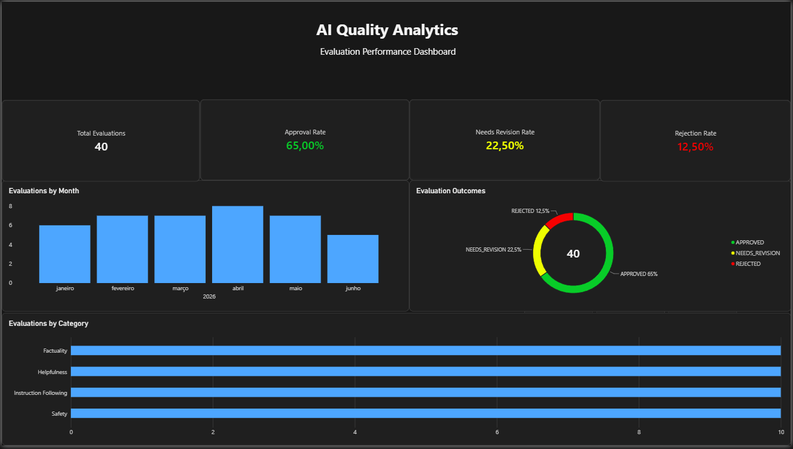

# AI Quality Analytics Dashboard

A data analytics project focused on monitoring AI response quality through structured evaluation data, SQL queries, and an interactive Power BI dashboard.

The project demonstrates how evaluation records can be transformed into quality metrics that support analysis, reporting, and quality assurance workflows.

## Dashboard Preview



## Project Objectives

- Analyze AI evaluation outcomes and quality indicators.
- Monitor approval, revision, and rejection rates.
- Track evaluation volume over time.
- Compare evaluation volume across quality categories.
- Practice SQL data analysis and Power BI dashboard development.

## Tools & Technologies

- **MySQL 8.0** — relational database and data validation.
- **SQL** — queries, aggregations, and analysis.
- **Microsoft Power BI** — data visualization and dashboard development.
- **DAX** — calculated measures and performance indicators.
- **GitHub** — version control and project documentation.

## Key Metrics

| Metric | Result |
|---|---:|
| Total evaluations | 40 |
| Approval rate | 65.0% |
| Needs revision rate | 22.5% |
| Rejection rate | 12.5% |
| Evaluation categories | 4 |

The dataset contains 40 sample evaluation records, evenly distributed across four categories, with 10 evaluations per category.

### Evaluation Categories

- **Factuality:** Checks whether claims are supported and factually consistent.
- **Safety:** Checks for harmful, disallowed, or unsafe response content.
- **Helpfulness:** Checks relevance, completeness, and usefulness to the request.
- **Instruction Following:** Checks whether the response follows the stated task and format.

## Dashboard Components

The Power BI report includes:

- **KPI Cards:** Total evaluations, approval rate, rejection rate, and needs revision rate.
- **Evaluations by Month:** Monthly evaluation volume.
- **Evaluation Outcomes:** Distribution of approved, needs-revision, and rejected evaluations.
- **Evaluations by Category:** Evaluation volume across the four quality categories.

## Repository Structure

```text
ai-quality-analytics/
├── data/
├── docs/
│   └── data-dictionary.md
├── powerbi/
│   ├── ai-quality-dashboard.pbix
│   └── dashboard-preview.png
├── sql/
│   ├── 01_create_database.sql
│   ├── 02_create_tables.sql
│   ├── 03_insert_sample_data.sql
│   └── 04_quality_analysis.sql
└── README.md
```

## SQL Analysis

The SQL scripts create the database and tables, insert sample records, and perform quality analysis.

Example query — evaluation volume by month:

```sql
SELECT
    DATE_FORMAT(evaluated_at, '%Y-%m') AS evaluation_month,
    COUNT(*) AS total_evaluations
FROM ai_quality_analytics.evaluations
GROUP BY DATE_FORMAT(evaluated_at, '%Y-%m')
ORDER BY evaluation_month;
```

Example query — outcome distribution:

```sql
SELECT
    outcome,
    COUNT(*) AS total_evaluations
FROM ai_quality_analytics.evaluations
GROUP BY outcome
ORDER BY total_evaluations DESC;
```

## DAX Measures

Approval Rate:

```dax
Approval Rate =
DIVIDE(
    CALCULATE(
        COUNTROWS('ai-quality-analytics evaluations'),
        'ai-quality-analytics evaluations'[outcome] = "APPROVED"
    ),
    COUNTROWS('ai-quality-analytics evaluations'),
    0
)
```

The dashboard also includes measures for rejection rate and needs revision rate.

## How to Reproduce the Project

1. Install MySQL 8.0 and Microsoft Power BI Desktop.
2. Clone or download this repository.
3. Run the SQL scripts in numerical order from the `sql/` directory.
4. Connect Power BI Desktop to the MySQL database.
5. Load the required tables and configure the data relationships.
6. Open `powerbi/ai-quality-dashboard.pbix` to explore the report.

Connection settings may need to be adjusted for your local MySQL environment.

## Data Disclaimer

This project uses fictional sample data created for demonstration and portfolio purposes. The metrics describe this sample dataset only and should not be interpreted as the measured performance of a production AI system.

## Skills Demonstrated

SQL querying and aggregation · Relational data modeling · Data validation · DAX measures · Power BI visualization · Quality metrics · Technical documentation · GitHub version control
